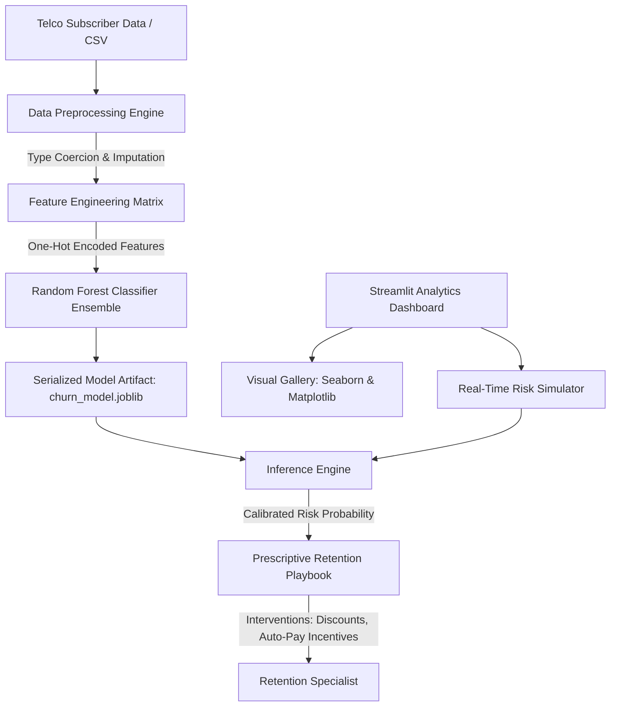
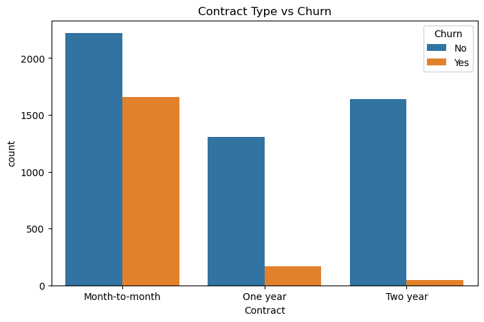
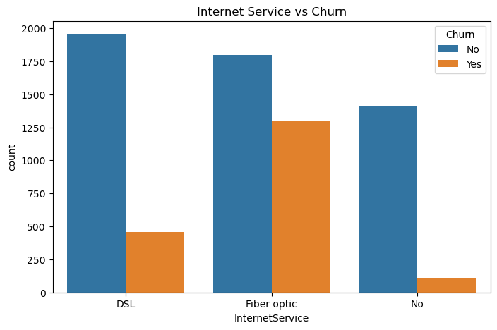
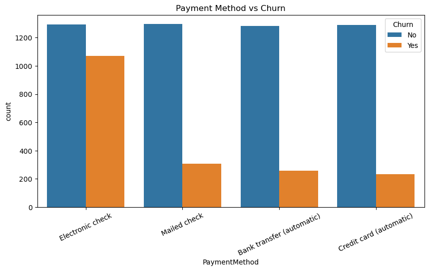
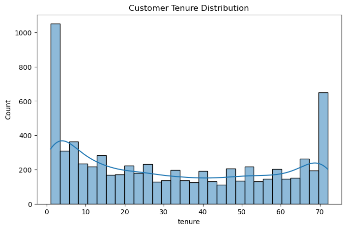
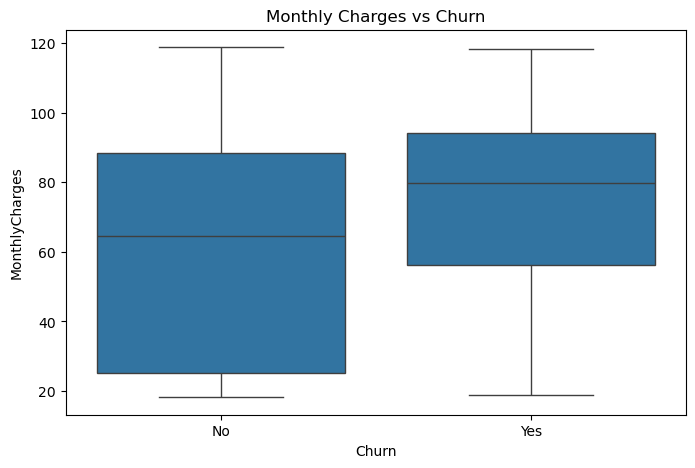
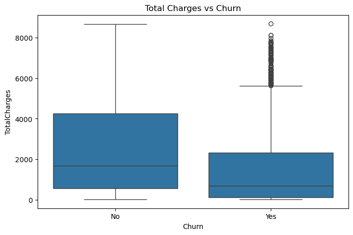

<div align="center">

# Telco Customer Churn Prediction & Analytics

**Machine-Learning Powered Customer Retention Platform with Automated Exploratory Data Analysis & Real-Time Churn Risk Scoring.**

[](app/app.py)
[](src/train_model.py)
[](tests/test_churn.py)
[](render.yaml)
[](LICENSE)

</div>

---

## 1. Executive Summary

Customer acquisition costs (CAC) in telecommunications consistently exceed retention expenses by a factor of $5\times$ to $7\times$. The **Telco Customer Churn Prediction & Analytics Platform** bridges raw subscriber telemetry and executive decision-making.

The system provides:
1. **Automated Exploratory Data Analysis:** Ingests subscriber datasets, validates schema integrity, and renders multi-variate statistical distributions across contracts, payment methods, and billing history.
2. **Supervised Random Forest Classifier:** Pre-processes high-cardinality categorical dimensions into aligned one-hot representations and fits an ensemble of decision trees balanced against class skew.
3. **Real-Time Churn Simulation:** An interactive decision dashboard allowing account executives to tweak customer tenure, contract types, and monthly charges to immediately obtain a calibrated churn probability and automated retention recommendations.

---

## 2. Machine Learning Architecture & Pipeline



---

## 3. Mathematical & Algorithmic Formulation

### Ensemble Decision Trees (Random Forest)
The classifier aggregates predictions from an ensemble of $B$ bootstrap-aggregated decision trees $\{T_b\}_{b=1}^B$:

$$\hat{P}(y = \text{Churn} \mid \mathbf{x}) = \frac{1}{B} \sum_{b=1}^{B} P_b(y = \text{Churn} \mid \mathbf{x})$$

At each candidate split $s$, the node partition maximizes information gain via **Gini Impurity**:

$$I_G(p) = 1 - \sum_{k \in \{0, 1\}} p_k^2$$

$$\Delta I_G = I_G(D) - \left( \frac{|D_L|}{|D|} I_G(D_L) + \frac{|D_R|}{|D|} I_G(D_R) \right)$$

---

## 4. Visual Analytics Gallery

The automated exploratory engine generates and persists the full suite of diagnostic behavioral plots:

| Contract Type vs. Churn | Internet Service vs. Churn | Payment Method vs. Churn |
| :---: | :---: | :---: |
|  |  |  |
| *Month-to-month contracts exhibit peak churn vulnerability* | *Fiber optic subscribers demonstrate higher price sensitivity* | *Electronic check transactions correlate with attrition* |

| Tenure Distribution | Monthly Charges vs. Churn | Total Charges vs. Churn |
| :---: | :---: | :---: |
|  |  |  |
| *Bimodal tenure: new joiners vs. loyal accounts* | *Higher median monthly charges drive churn decisions* | *Cumulative spend profile across retained cohort* |

---

## 5. Quickstart & Local Installation

### Prerequisites
- Python 3.10, 3.11, or 3.12
- Git

### 1. Clone & Set Up Environment
```bash
git clone https://github.com/purnachandra-maharana/customer-churn-prediction.git
cd customer-churn-prediction

# Create and activate virtual environment
python -m venv venv
# Windows:
venv\Scripts\activate
# macOS / Linux:
source venv/bin/activate

# Install dependencies
pip install -r requirements.txt
```

### 2. Train the Model Artifact
```bash
python src/train_model.py
```
*Output: `Model trained successfully. Serialized to models/churn_model.joblib`*

### 3. Launch Streamlit Application
```bash
streamlit run app/app.py
```
Open your browser at `http://localhost:8501`. Test with the bundled 120-customer dataset or upload your custom Telco CSV.

---

## 6. Automated Testing Suite

The repository features an automated Pytest test harness verifying feature matrix normalization, target extraction, classifier fit, and real-time probability calibration:

```bash
pytest tests -v
```

### Verified Test Matrix:
- `test_preprocess_data_shapes_and_features`: Verifies one-hot feature vector shape ($N \times 11$) and numeric coercion of whitespace strings.
- `test_preprocess_without_target`: Validates inference-time preprocessing when ground-truth `Churn` label is absent.
- `test_train_model`: Confirms Random Forest estimator instantiation and convergence.
- `test_predict_and_probability`: Validates probability outputs reside strictly within $[0.0, 1.0]$.
- `test_serialized_model_inference`: Confirms production model deserialization and end-to-end forward scoring.

**Result: 5 passed in 2.21s.**

---

## 7. Cloud Deployment (Render Blueprint)

This repository includes an Infrastructure-as-Code manifest (`render.yaml`) optimized for zero-configuration deployment as a **Render Web Service**.

### Deploying to Render
1. Fork or push this repository to GitHub.
2. In the [Render Dashboard](https://dashboard.render.com), click **New +** > **Blueprint**.
3. Select this repository. Render will automatically parse `render.yaml` and configure:
   - **Service Type:** Web Service (Python)
   - **Build Command:** `pip install -r requirements.txt && python src/train_model.py`
   - **Start Command:** `streamlit run app/app.py --server.port $PORT --server.address 0.0.0.0 --server.headless true`
   - **Health Check Path:** `/_stcore/health`

---

## 8. Repository Structure

```
customer-churn-prediction/
├── .github/
│   └── workflows/
│       └── ci.yml               # Automated Pytest CI matrix across Python 3.10-3.12
├── app/
│   └── app.py                   # Streamlit analytics & real-time risk dashboard
├── data/
│   └── sample_churn.csv         # Bundled 120-subscriber Telco evaluation dataset
├── images/                      # Pre-generated Seaborn diagnostic visualizations
│   ├── churn_distribution.png
│   ├── contract_vs_churn.png
│   ├── internet_vs_churn.png
│   ├── monthlycharges_vs_churn.png
│   ├── payment_vs_churn.png
│   ├── tenure_distribution.png
│   └── totalcharges_vs_churn.png
├── models/
│   └── churn_model.joblib       # Serialized Random Forest classifier
├── notebooks/
│   └── 01_customer_churn_analysis.ipynb
├── src/
│   ├── __init__.py
│   ├── data_preprocessing.py    # Robust cleaning, coercion & feature one-hot encoding
│   ├── predict.py               # Model deserialization & calibrated probability inference
│   └── train_model.py           # Random Forest model training & evaluation
├── tests/
│   ├── conftest.py              # Pytest sys.path bootstrap
│   └── test_churn.py            # 5 unit & integration tests
├── render.yaml                  # Render Web Service blueprint
├── requirements.txt             # Dependency specification
└── README.md                    # Startup-grade technical documentation
```

---

## 9. Security & Privacy Disclosure

- **Zero Path Leakage:** Relative paths are strictly enforced using `pathlib.Path(__file__).resolve().parent.parent`.
- **Zero Third-Party Telemetry:** Streamlit usage data collection is disabled (`STREAMLIT_BROWSER_GATHER_USAGE_STATS=false`).
- **In-Memory Scoring:** Customer feature payloads entered during live simulation are evaluated in-memory and discarded upon session disconnect.

---

## 10. Author & Attribution

**Purna Chandra Maharana**
- Portfolio: [github.com/purnachandra-maharana](https://github.com/purnachandra-maharana)
- Reference Standard: [Inkloom AI](https://github.com/purnachandra-maharana/inkloom-ai)
