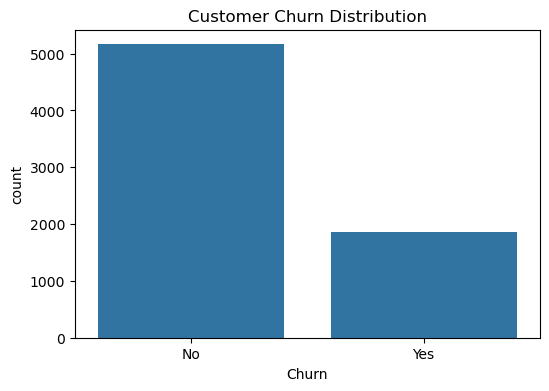

# Customer Churn Prediction

## Project Overview

This project predicts whether a telecom customer is likely to churn (leave the service) using Machine Learning.

The project includes:

- Data Cleaning
- Exploratory Data Analysis (EDA)
- Feature Engineering
- Machine Learning Models
- Model Evaluation
- Streamlit Dashboard
- GitHub Documentation

---

## Dataset

Dataset Used:

Telco Customer Churn Dataset

Source:
https://www.kaggle.com/datasets/blastchar/telco-customer-churn

---

## Technologies Used

- Python
- Pandas
- NumPy
- Matplotlib
- Seaborn
- Scikit-Learn
- Streamlit
- Joblib

---

## Project Structure

```text
customer-churn-prediction/

├── data/
│   ├── raw/
│   └── processed/
│
├── notebooks/
│   └── 01_customer_churn_analysis.ipynb
│
├── src/
│   ├── data_preprocessing.py
│   ├── train_model.py
│   └── predict.py
│
├── models/
│
├── app/
│   └── app.py
│
├── images/
│
├── README.md
├── requirements.txt
└── .gitignore
```

---

## Exploratory Data Analysis

### Churn Distribution



### Contract Type vs Churn


### Monthly Charges vs Churn


---

## Machine Learning Models

- Logistic Regression
- Decision Tree
- Random Forest

---

## Evaluation Metrics

- Accuracy
- Precision
- Recall
- F1 Score
- ROC-AUC

---

## Streamlit Dashboard

Features:

- Upload CSV
- Automatic Analysis
- Interactive Charts
- Churn Prediction
- Download Results

---

## How to Run

### Install Requirements

```bash
pip install -r requirements.txt
```

### Launch Dashboard

```bash
cd app
streamlit run app.py
```

---

## Author

B.Tech CSE Student

Machine Learning & Data Analytics Enthusiast